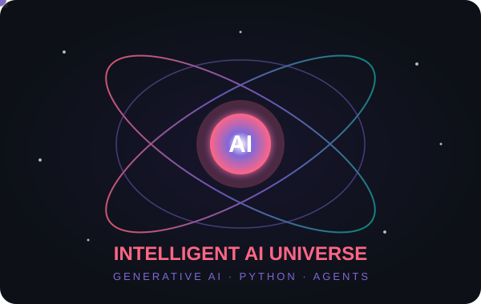

 

# MANAHYL KHALID

### AI & PYTHON DEVELOPER

 

**GENERATIVE AI · RAG · AGENTIC SYSTEMS**

Building intelligent applications through AI engineering, advanced retrieval and Python development.

  

  

---

## ✳ ABOUT

AI & Python Developer specializing in **Generative AI, Large Language Models, Retrieval-Augmented Generation (RAG), and Agentic Systems**.

I build intelligent application workflows by combining LLM integration, semantic retrieval, AI agents, external tool connectivity, and Python backend services.

My technical focus includes developing context-aware AI solutions, designing structured agent workflows, and connecting intelligent systems with real-world applications through reliable APIs.

**Engineering focus:** Intelligent automation · Knowledge retrieval · Agent orchestration · AI-powered applications.

---

### ◈ CORE EXPERTISE

---

## ⚡ TECHNOLOGY ECOSYSTEM

Tools and frameworks powering my development work

**01 — Programming & Backend**

**02 — AI & Agent Frameworks**

`LangChain` &nbsp; `LangGraph` &nbsp; `CrewAI` &nbsp; `MCP` &nbsp; `LlamaIndex` &nbsp; `OpenAI SDK`

**03 — Retrieval & Knowledge Systems**

`ChromaDB` &nbsp; `FAISS` &nbsp; `BM25` &nbsp; `HNSW` &nbsp; `Embeddings` &nbsp; `Reranking`

**04 — Application Development & Tools**

---

###  NOVASHIELD AI

**AI-Powered Cybersecurity Platform**

An intelligent security platform combining AI-driven threat analysis, security monitoring, and automated scanning workflows.

`Python` · `FastAPI` · `RAG` · `AI Agents` · `MCP` · `Flutter`

###  RAG DOCUMENT Q&A

**AI Knowledge Assistant**

A document-based question-answering system that uses contextual retrieval and language models to generate grounded answers from source documents.

`Python` · `LangChain` · `RAG` · `Vector Search` · `FastAPI`

###  AI VOICE ASSISTANT

**Conversational AI Application**

A Python-powered voice assistant integrating speech recognition, Gemini API, conversation handling, and text-to-speech for interactive voice communication.

`Python` · `Gemini API` · `Speech Recognition` · `PyAudio` · `pyttsx3`

---

## LET'S CONNECT

 

  

 

MANAHYL KHALID · AI & PYTHON DEVELOPER

